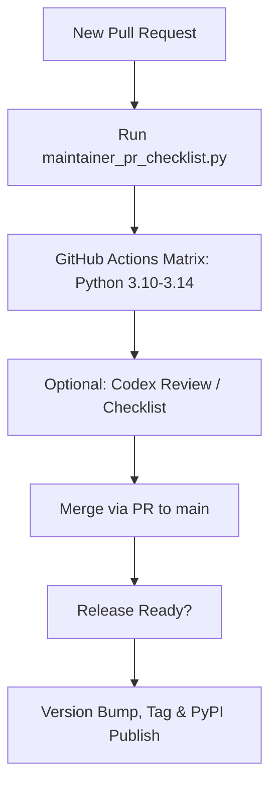

# Maintainer Playbook: Review, Triage, and Release Automation

Tracks [issue #7](https://github.com/yunusarda-sudo/handoffstone/issues/7).

This playbook documents the operational workflow for maintaining `handoffstone`, including pull request triage, agent-assisted code review (via Codex CLI), and reproducible releases.

---

## 1. Principles & Non-Negotiables

Every outside contribution and maintainer PR must satisfy these invariant rules:

1. **Stdlib-only Core:** `handoffstone.py` and `handoffstone_mcp.py` must contain **zero** third-party dependencies.
2. **Untouched Runtime Dependencies:** `pyproject.toml` `[project.dependencies]` must remain empty (`[]`).
3. **Benchmark Teeth:** Negative controls in `test_bench_handoffstone.py` (`test_empty_transport_scores_zero`, `test_garbage_transport_scores_below_real_summary`, `test_metric_is_sensitive_to_sabotage`) must never be weakened or deleted.
4. **Honest Reporting:** Reversals or losses against summaries must be documented, never masked by changing benchmark parameters.
5. **No Secrets or Real Stores:** No real credentials, API tokens, or actual project JSONL stores may be committed.
6. **PR-Only Main:** `main` moves **only** via a pull request whose CI matrix (Python 3.10–3.14) is green. Direct pushes and force-pushes are disallowed.

---

## 2. Pull Request Triage Workflow

When a pull request arrives:



### Step 2.1 — Run the Automated Maintainer Gate
Before reviewing code line-by-line, run the maintainer gate script:

```bash
python3 scripts/maintainer_pr_checklist.py --check
```

This verifies AST import boundaries, runtime dependencies, negative controls, and changelog updates.

### Step 2.2 — Codex-Assisted Review (Optional CLI Agent)
Maintainers with Codex API credits can run an automated, zero-coupling review without modifying or network-coupling the core library.

Run Codex review non-interactively against the current PR branch diff:

```bash
codex review --target origin/main
```

Or generate a structured review summary:

```bash
codex exec "Read git diff origin/main...HEAD. Confirm whether it violates: (1) stdlib-only in handoffstone.py, (2) benchmark negative controls, (3) secret filtering. Output a concise maintainer note."
```

If Codex or network access is unavailable, the manual review checklist in `scripts/maintainer_pr_checklist.py` serves as the fail-closed fallback.

### Step 2.3 — Verify the Full Test Suite Locally
Execute all verification suites in an isolated virtual environment:

```bash
python3 -m venv .venv
source .venv/bin/activate
pip install -e '.[dev]' build twine

python3 test_handoffstone.py
python3 test_storage_security.py
python3 test_cross_client_fidelity.py
python3 test_mcp_bridge.py
python3 test_bench_handoffstone.py
python3 -B -m unittest -v test_reliability
python3 test_schema_contract.py
python3 handoffstone.py
```

### Step 2.4 — Check the CI Status
Confirm on GitHub that all 5 matrix jobs (`CI/Python 3.10`, `3.11`, `3.12`, `3.13`, `3.14`) have passed:

```bash
gh pr checks <PR_NUMBER>
```

### Step 2.5 — Merge the Pull Request
Merge via merge commit or squash commit and delete the feature branch:

```bash
gh pr merge <PR_NUMBER> --merge --delete-branch
```

---

## 3. Release Playbook

Follow this sequence to publish a new release:

### 3.1 Prepare the Version Bump
1. Open a new branch `chore/release-vX.Y.Z`:
   ```bash
   git checkout -b chore/release-vX.Y.Z
   ```
2. Update `pyproject.toml`:
   ```toml
   [project]
   version = "X.Y.Z"
   ```
3. Update `CHANGELOG.md`:
   - Rename `## [Unreleased]` to `## [X.Y.Z] - YYYY-MM-DD`.
   - Add a new empty `## [Unreleased]` section above it.
   - Add release compare links at the bottom.
4. Verify package build and twine check:
   ```bash
   python -m build
   twine check dist/*
   ```
5. Commit and open PR:
   ```bash
   git commit -am "release: prepare vX.Y.Z"
   git push -u origin chore/release-vX.Y.Z
   gh pr create --title "release: prepare vX.Y.Z"
   ```

### 3.2 Tag and Publish
1. Wait for CI matrix to turn green, then merge the release PR to `main`.
2. Checkout `main` and pull:
   ```bash
   git checkout main && git pull origin main
   ```
3. Create and push an annotated Git tag:
   ```bash
   git tag -a "vX.Y.Z" -m "release: vX.Y.Z"
   git push origin "vX.Y.Z"
   ```
4. Draft the GitHub Release:
   ```bash
   gh release create "vX.Y.Z" --title "vX.Y.Z" --notes-file <(sed -n '/^## \[X.Y.Z\]/,/^## \[/p' CHANGELOG.md | head -n -1)
   ```
5. **PyPI Trusted Publishing:** Once the release is published, the `.github/workflows/publish.yml` workflow automatically builds and pushes the distribution wheels to PyPI using GitHub OIDC. Verify the workflow run:
   ```bash
   gh run list --workflow=publish.yml
   ```
